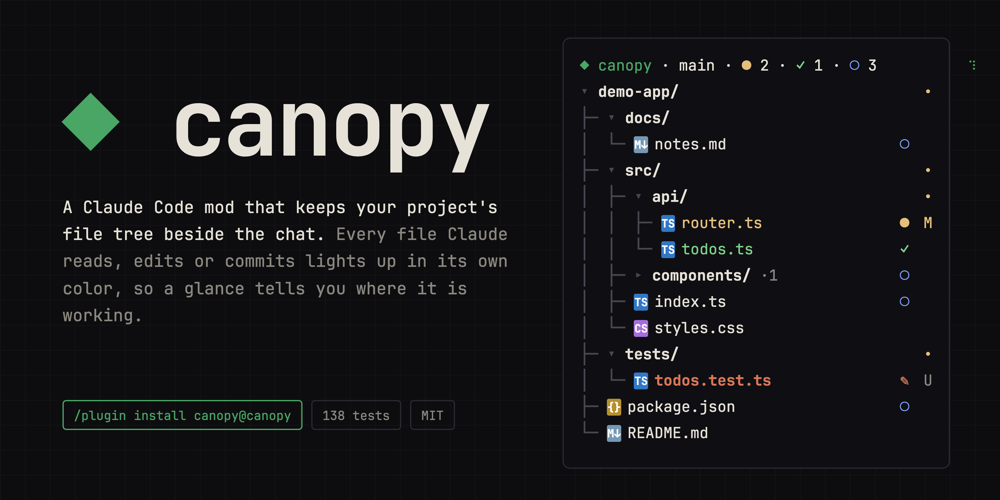
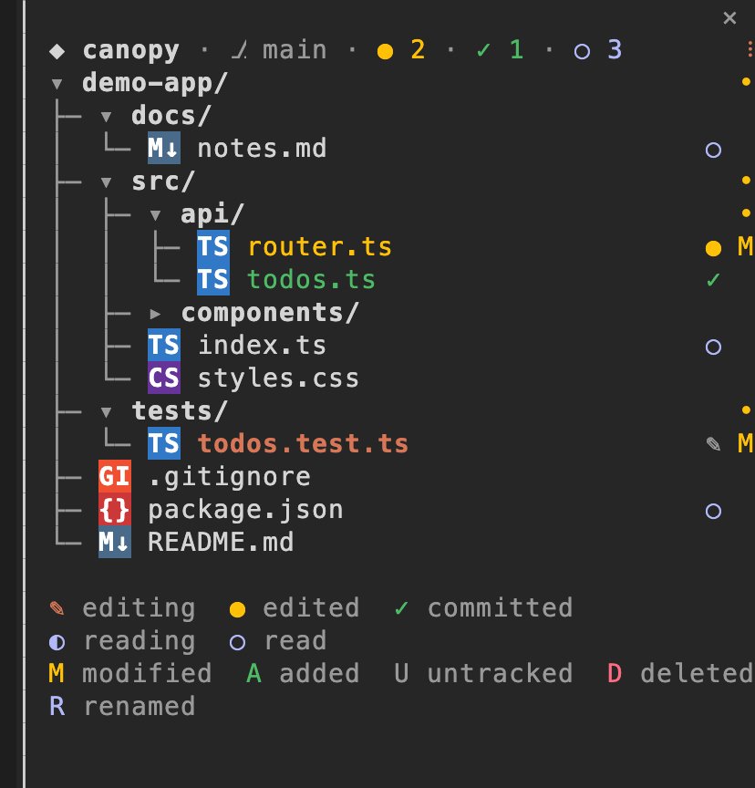

<div align="center">



# ◆ canopy

**A Claude Code mod that keeps your project's file tree beside the chat, and lights each file as Claude reads, edits or commits it.**

[](https://code.claude.com/docs/en/plugins/mods/overview)
[](#compatibility)
[](LICENSE)


<sub>An animation of the pane, drawn with canopy's own layout; reads and edits are sped up.</sub>



</div>

Claude's transcript tells you *what* it did, one tool call at a time. Canopy shows you
**where**: your project's tree sits beside the conversation, folders open as Claude works in
them, and every file it touches lights up. A glance tells you what it's reading, what it
changed, and what's already committed.

```text
│ ◆ canopy · ⎇ main · ● 2 · ✓ 1 · ○ 3       ⠹
│ ▾ my-app/                                 •
│ ├─ ▸ docs/ ·1                           ○
│ ├─ ▾ src/                                 •
│ │  ├─ ▾ components/                       •
│ │  │  ├─ TS Button.tsx                  ✎ M
│ │  │  └─ TS Header.tsx                  ◐
│ │  ├─ TS index.ts                       ✓
│ │  └─ TS utils.ts                       ● M
│ ├─ M↓ notes.md                            U
│ ├─ {} package.json                      ○
│ └─ M↓ README.md
│
│ ✎ editing  ● edited  ✓ committed
│ ◐ reading  ○ read
│ M modified  A added  U untracked  D deleted
│ R renamed
```

*(In the pane each name takes its state's color, and each badge sits on a tile in its
language's color.)*

## Install

Inside Claude Code:

```text
/plugin marketplace add flaviorg/canopy
/plugin install canopy@canopy
```

Then start a new session, or run `/reload-plugins`. Canopy is also listed in my
[claude-mods](https://github.com/flaviorg/claude-mods) marketplace with my other mods.

## What lights up

Every file Claude touches keeps a state for the whole session, each in its own color, so a
glance tells what is happening now, what changed and waits for a commit, and what landed.

| | State | When | How it shows |
|---|---|---|---|
| ✎ | **editing** | Claude is writing the file: `Edit`, `Write`, `NotebookEdit`, or a shell command that changed it | The name turns bold in Claude's orange, and the pencil pulses bright and dim, for 8 seconds |
| ● | **edited** | Claude changed it and it isn't committed yet | The name stays yellow, like git's `M`, until a commit takes it. Put back (`git restore`, `checkout`, `stash`), it goes back to read |
| ✓ | **committed** | A commit took it: one Claude made (every file it took, new ones included) or one you made in your own terminal or editor | The name turns green, with a check, until Claude changes it again |
| ◐ | **reading** | Claude is reading it: the `Read` tool, or `cat`, `head`, `tail`, `sed -n`, `grep`, `rg`, `wc`… in the shell | The name turns blue, with a turning quarter moon, for 8 seconds. A `Read` lights from the moment Claude asks, so one waiting for your permission is already lit; a shell read lights once the command has run |
| ○ | **read** | Claude read it earlier | A blue ring beside its plain name. Reading a changed file spins for a moment, then shows the change again |
| `M` `A` `D` `R` `U` | git | `git status` | Modified, added, deleted, renamed, untracked: right-aligned, in the theme's colors. A folder rolls everything inside it up into one small dot (`•`) in the color of the most serious change |
| `·3` | inside a folder | A closed folder holds files Claude touched | The folder's name, its count and its glyph take the strongest state inside: what is happening now, then what waits for a commit, then what landed, then what was read |
| `TS` `{}` `M↓` | file type | Always | A two-letter badge on a tile in the language's color (`TS`, `JS`, `{}`, `M↓`, `CS`, `PY`, `$_`…); special files get their own (`package.json`, `Dockerfile`, `.gitignore`, `CLAUDE.md`…) |

The header counts the files changed and not committed (`●`), committed (`✓`) and only read
(`○`) this session, and a spinner turns while Claude is reading or writing. Folders Claude
works in open by themselves and close again a minute after it leaves, keeping their count.
Press a folder (click it, or Tab to it and press Enter) to open or close it; a folder you
close stays closed. With **Follow** on, the pane scrolls to the file Claude is on. In a
narrow pane, rows nested deeper than half its width show their last levels after a dim `⋯`,
so file names stay readable.

While the pane is shown, canopy reads `.gitignore` again, rescans the open folders and asks
git again every five seconds, so changes made outside Claude appear too.

## Commands

| Command | What it does |
|---|---|
| `/canopy` | Shows the tree, or hides it when it's showing. When another mod's pane is in front, brings canopy's back |
| `/canopy refresh` | Reads `.gitignore` again and rescans everything |

## Options

Set them with `/plugin configure canopy@canopy`:

| Option | Values | Default | What it does |
|---|---|---|---|
| `start` | `on`, `off` | `on` | `on` opens the tree when a session starts, if the terminal is wide enough (otherwise a toast says to run `/canopy`) |
| `activity` | `all`, `writes`, `none` | `all` | Which of Claude's file activity lights the tree. `writes` skips reads; `none` keeps a plain tree with git badges |
| `ignore` | comma-separated names, `*.ext` suffixes or `folder/path` paths | *(empty)* | More to hide, on top of `.gitignore` and the built-ins (`node_modules`, `.git`, `dist`, `build`, `.next`, `coverage`, `__pycache__`, `.venv`, `target`, `.turbo`, `.cache`, `.DS_Store`) |
| `follow` | `on`, `off` | `on` | Scroll to the file Claude is touching |
| `icons` | `badges`, `swatches` | `badges` | `badges` draws a two-letter tile in each file type's color; `swatches` a small colored square (`◆` for the files that define a project) |

## Privacy

Canopy reads directory listings under your project root and the root's `.gitignore`. It
never opens your files. It runs exactly three commands, all read-only, in the project root:
`git status --porcelain=v1 -b -z` (with `--untracked-files=all` just before a commit, so it
can tell which new files the commit took), `git rev-parse --verify -q HEAD` (so it can tell a
commit you made from a change you put back) and `git rev-parse --show-prefix`. It makes no
network requests, and nothing leaves your machine. You can confirm this before installing:

```bash
claude plugin validate ./canopy
```

The `calls:` line lists every mods API call it makes.

## Compatibility

Tested with Claude Code **2.1.296** in the terminal and the Desktop app's Code tab. Mods need
Claude Code 2.1.287 or later. In fullscreen from 110 columns the pane docks beside the
transcript (44 columns wide); otherwise it sits above the prompt. Claude Code places a pane
a mod opens on its own only from 144 columns, so on a narrower terminal canopy waits for you
to run `/canopy`.

Claude Code shows one mod pane at a time, with a tab for each, docked or above the prompt:
when another mod opens its pane (say [crew](https://github.com/flaviorg/crew) as Claude
delegates), click canopy's tab or run `/canopy` to bring the tree back. In fullscreen, Claude Code's own diff panel may open beside
the transcript when a file changes and cover the dock; `/diff` closes it, and Claude Code
remembers that.

Large projects stay responsive: a folder draws at most 500 entries and the tree at most
2,000 rows, and the rest fold into `… N more` rows, so one huge folder never hides the others. In a monorepo, start Claude in a package folder and the badges follow that folder.

## Development

```bash
claude plugin validate --strict .   # manifest, hooks and calls
claude plugin test .                 # 138 tests, no session or sign-in needed
claude --plugin-dir .                # try it in a session; edits hot-reload
```

`hooks/register.ts` is the only file that touches the mods API. The rest are plain modules
with one job each, tested on their own: `tree.ts` (ignore rules and guide lines),
`activity.ts` (marks, heat and each file's state), `git.ts` (status parsing), `bashpaths.ts`
(what a shell command reads or changes), `view.ts` (the look) and `filetypes.ts` (badges and
swatches). Design notes
live in [`docs/superpowers/plans`](docs/superpowers/plans).

## Credits

Inspired by the idea of a live file tree for coding agents; written from scratch against the
public mods API.

## License

[MIT](LICENSE) © flaviorg
