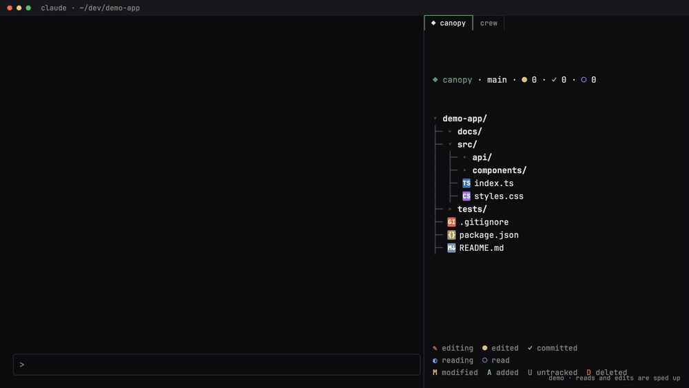

<div align="center">

# ◆ canopy

**A Claude Code mod that keeps your project's file tree beside the chat, and lights each file as Claude reads, edits or commits it.**

[](https://code.claude.com/docs/en/plugins/mods/overview)
[](#compatibility)
[](LICENSE)



</div>

Claude's transcript tells you *what* it did, one tool call at a time. Canopy shows you
**where**: your project's tree sits beside the conversation, folders open as Claude works in
them, and every file it touches lights up. A glance tells you what it's reading, what it
changed, and what's already committed.

```text
╭──────────────────────────────────────────────╮
│ ◆ canopy · ⎇ main · ✎ 2 · ◉ 3              ⠹ │
│ ▾ my-app/                                  ● │
│ ├─ ▸ docs/ ·1                                │
│ ├─ ▾ src/                                  ● │
│ │  ├─ ▾ components/                        ● │
│ │  │  ├─ ▪ Button.tsx                    ● M │
│ │  │  └─ ▪ Header.tsx                    ◐   │
│ │  ├─ ▪ index.ts                         ✓   │
│ │  └─ ▪ utils.ts                           M │
│ ├─ ◆ package.json                            │
│ ├─ ◆ README.md                           ·   │
│ └─ ▪ notes.md                              U │
│                                              │
│ ● editing  ◐ reading  ✓ committed            │
│ M modified  A added  U new  D deleted        │
╰──────────────────────────────────────────────╯
```

## Install

Inside Claude Code:

```text
/plugin marketplace add flaviorg/canopy
/plugin install canopy@canopy
```

Then start a new session, or run `/reload-plugins`. Canopy is also listed in my
[claude-mods](https://github.com/flaviorg/claude-mods) marketplace with my other mods.

## What lights up

| | When | How it shows |
|---|---|---|
| ◐ | Claude reads a file: the `Read` tool, or `cat`, `head`, `tail`, `sed -n`, `grep`, `rg`, `wc`… in the shell | The name takes your theme's suggestion color with a spinner for 8 seconds (from the moment Claude asks, so a read waiting for your permission is already lit), then a quiet `·` for a minute |
| ● | Claude edits a file: `Edit`, `Write`, `NotebookEdit`, or a shell command that changed it | The name turns bold green with a pulsing dot, then stays green for a minute |
| ✓ | Claude commits | Every file the commit took gets a green check for a minute |
| `M` `A` `D` `R` `U` | `git status` | Modified, added, deleted, renamed, untracked: right-aligned, in the theme's colors. A folder rolls everything inside it up into one dot |
| `·3` | Activity inside a closed folder | The count, in canopy green |
| ▪ ◆ | Always | A swatch in each file type's color; `◆` marks the files that define a project (`package.json`, `README.md`, `CLAUDE.md`, `Dockerfile`…) |

The header counts the files edited (`✎`) and only read (`◉`) this session, and spins while
anything is live. Folders Claude works in open by themselves and close again a minute after
it leaves. Press a folder (click it, or Tab to it and press Enter) to open or close it; a
folder you close stays closed, showing its `·N` count instead. With **Follow** on, the pane
scrolls to the file Claude is on.

While the pane is shown, canopy reads `.gitignore` again, rescans the open folders and asks
git again every five seconds, so changes made outside Claude appear too.

## Commands

| Command | What it does |
|---|---|
| `/canopy` | Shows the tree, or hides it when it's showing |
| `/canopy refresh` | Reads `.gitignore` again and rescans everything |

## Options

Set them with `/plugin configure canopy@canopy`:

| Option | Values | Default | What it does |
|---|---|---|---|
| `start` | `on`, `off` | `on` | `on` opens the tree when a session starts, if the terminal is wide enough (otherwise a toast says to run `/canopy`) |
| `activity` | `all`, `writes`, `none` | `all` | Which of Claude's file activity lights the tree. `writes` skips reads; `none` keeps a plain tree with git badges |
| `ignore` | comma-separated names | *(empty)* | More names to hide, on top of `.gitignore` and the built-ins (`node_modules`, `.git`, `dist`, `build`, `.next`, `coverage`, `__pycache__`, `.venv`, `target`, `.turbo`, `.cache`, `.DS_Store`) |
| `follow` | `on`, `off` | `on` | Scroll to the file Claude is touching |

## Privacy

Canopy reads directory listings under your project root and the root's `.gitignore`. It
never opens your files. It runs exactly two commands, both read-only, in the project root:
`git status --porcelain=v1 -b -z` (with `--untracked-files=all` just before a commit, so it
can tell which new files the commit took) and `git rev-parse --show-prefix`. It makes no
network requests, and nothing leaves your machine. You can confirm this before installing:

```bash
claude plugin validate ./canopy
```

The `calls:` line lists every mods API call it makes.

## Compatibility

Tested with Claude Code **2.1.296** in the terminal and the Desktop app's Code tab. Mods need
Claude Code 2.1.287 or later. In fullscreen from 110 columns the pane docks beside the
transcript (44 columns wide); otherwise it sits above the prompt. Claude Code places a pane
a mod opens on its own only from 144 columns, so on a narrower terminal canopy waits for you
to run `/canopy`.

Large projects stay responsive: a folder draws at most 500 entries and the tree at most
2,000 rows, and the rest fold into `… N more` rows, so one huge folder never hides the others. In a monorepo, start Claude in a package folder and the badges follow that folder.

## Development

```bash
claude plugin validate --strict .   # manifest, hooks and calls
claude plugin test .                 # 88 tests, no session or sign-in needed
claude --plugin-dir .                # try it in a session; edits hot-reload
```

`hooks/register.ts` is the only file that touches the mods API. The rest are plain modules
with one job each, tested on their own: `tree.ts` (ignore rules and guide lines),
`activity.ts` (marks and heat), `git.ts` (status parsing), `bashpaths.ts` (what a shell
command reads or changes), `view.ts` (the look) and `filetypes.ts` (swatches). Design notes
live in [`docs/superpowers/plans`](docs/superpowers/plans).

## Credits

Inspired by the idea of a live file tree for coding agents; written from scratch against the
public mods API.

## License

[MIT](LICENSE) © flaviorg
